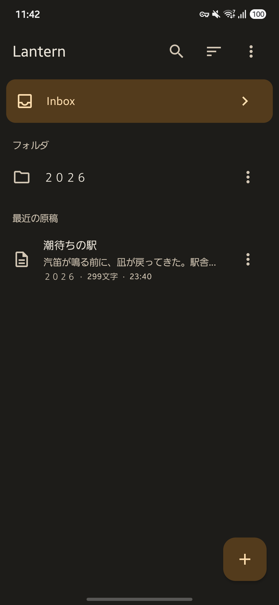
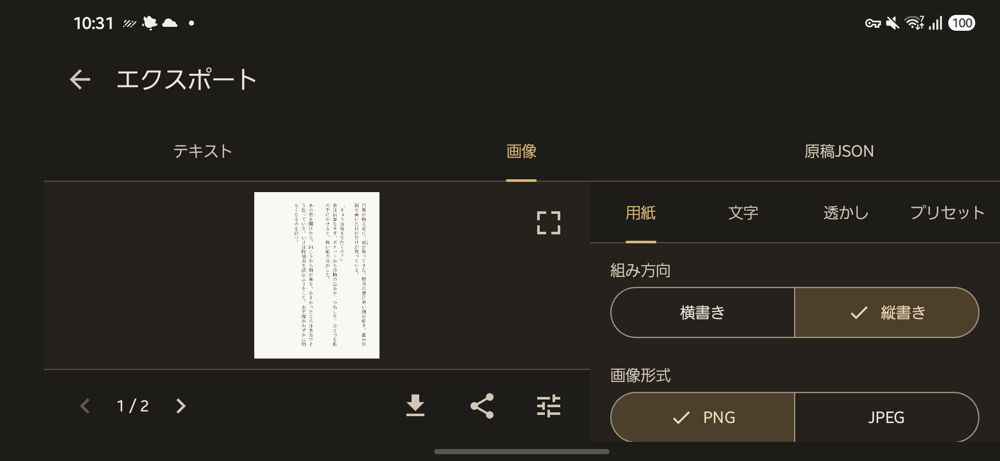

# Lantern

[日本語](README.md)

Lantern is an Android writing app for Japanese short fiction and fan fiction. Write offline, organize drafts in folders, and prepare text or images for sharing.

- Ruby, emphasis marks, bold, italic and page breaks
- Autosave, undo and a keyboard toolbar
- Hierarchical folders, search, trash and backup
- Text export for services including pixiv and X, and horizontal or vertical image export

Requires Android 10 or later. A signed release is being prepared. No release APK is available yet.

Drafts are stored locally by default. A user-selected folder can be used through Android's storage picker. Export backups to a separate location before removing the app or changing devices. Android system backup is disabled.

Install JDK 17 and Android SDK Platform 37.1 and Build-Tools 36.0.0, set `JAVA_HOME` and `ANDROID_HOME`, and run `./gradlew :app:assembleDebug` or `./gradlew :app:assembleRelease`. The release build is unsigned unless signed separately.

For release signing, supply an existing key using `LANTERN_KEYSTORE`, `LANTERN_STORE_PASSWORD`, `LANTERN_KEY_ALIAS`, and `LANTERN_KEY_PASSWORD` as environment variables. Keep the key and passwords outside the repository. If an installed debug build has a different signature, first export and verify a backup, then uninstall the debug build, install the signed release, and restore the backup. Uninstalling removes app-local data.

See [privacy](PRIVACY.md), [third-party notices](THIRD_PARTY_NOTICES.md), and [issues](https://github.com/sider51/Lantern/issues). Source code is available under the [MIT License](LICENSE). Official logos and brand assets are excluded and all rights are reserved as described in [BRAND_LICENSE.md](BRAND_LICENSE.md).
